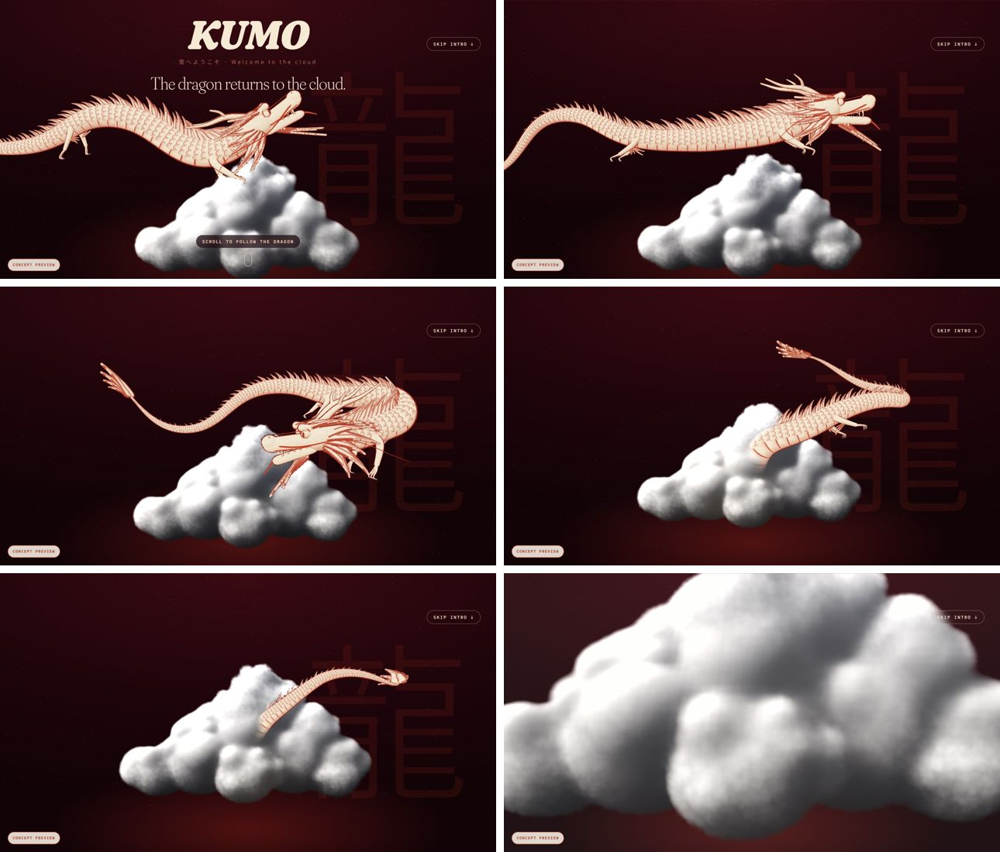
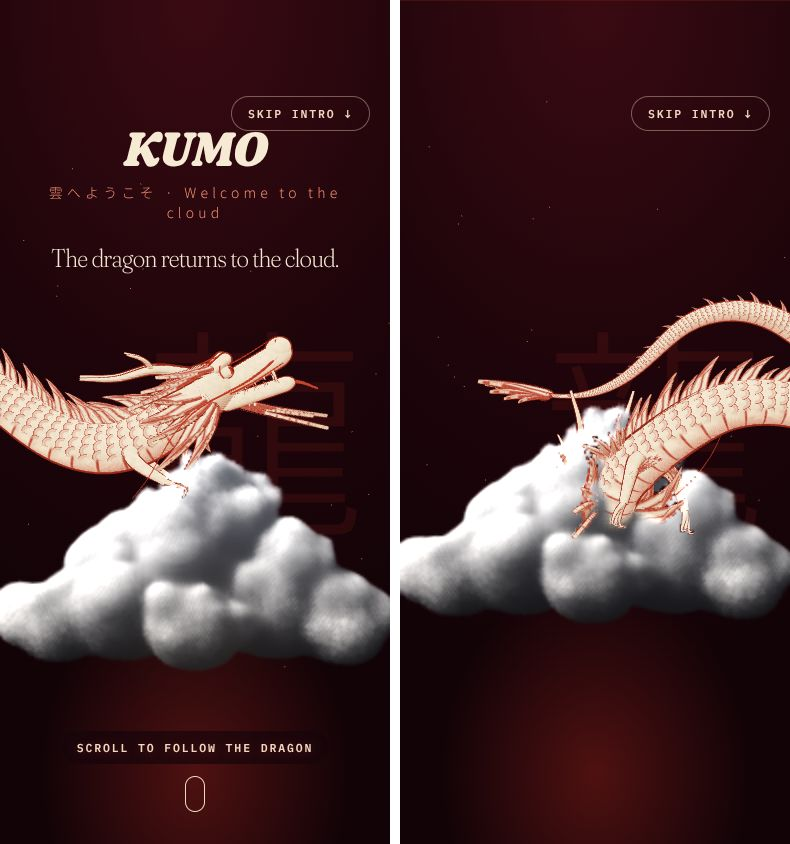

# KUMO 雲: concept website (Mark 3)

A bilingual (English / Arabic) concept website proposal for **KUMO**, a Kyoto home-inspired *famiresu* (Japanese family restaurant) in a reimagined 1980s villa on Al Wasl Road, Dubai. Sushi bar, robata grill, a glowing matcha bar, and **Café Kumo** slow mornings from 8 AM.

This is the third iteration of the concept. It opens with a scroll-driven 3D scene, then turns into a menu you can search, filter, plan with and even ask in plain language.



| | |
|---|---|
| **Status** | Concept / proposal. Not deployed. Marked `noindex` while `isConcept` is `true` |
| **Languages** | English (`/`) and Arabic (`/ar/`, full right-to-left layout, Arabic-Indic numerals) |
| **Output** | Fully static site (no server, no database, no network calls from the interactive features) |
| **Stack** | Astro, Tailwind CSS v4, GSAP + ScrollTrigger, Lenis, three.js, TypeScript |
| **Menu data** | 88 dishes and drinks across two menus (main and Café Kumo), with Arabic translations |

## Table of contents

1. [Highlights](#highlights)
2. [What's on the page](#whats-on-the-page)
3. [Screenshots and intro video](#screenshots-and-intro-video)
4. [Tech stack](#tech-stack)
5. [Getting started](#getting-started)
6. [Project structure](#project-structure)
7. [Editing the content](#editing-the-content)
8. [How the interactive features work](#how-the-interactive-features-work)
9. [Design system](#design-system)
10. [Motion, performance and accessibility](#motion-performance-and-accessibility)
11. [SEO and structured data](#seo-and-structured-data)
12. [Images](#images)
13. [Deploying](#deploying)
14. [Go-live checklist](#go-live-checklist)
15. [Notes and disclaimer](#notes-and-disclaimer)

## Highlights

- **The dragon intro.** A procedural Japanese dragon (*ryū*), drawn like a red-pencil illustration on cream paper, flies into a ray-marched volumetric cloud as you scroll. The cloud is lit from inside by small lightning strikes and the dragon disappears *into* it.
- **Two menus, one slow day.** The restaurant's time in Dubai decides which menu opens first: **Café Kumo** (8 AM to 1 PM) or the **main menu** (from 12 PM until close). A live status pill says what is open and until when.
- **Morning and evening moods** (朝 / 夜). The whole palette shifts between vermilion evening and matcha-green morning, set by Dubai time and switchable by hand.
- **Menu explorer** with chapters, search and filters (spicy, vegetarian, no raw), and a "available now" notion based on the clock.
- **Ask the cloud.** Type a craving in your own words (English or Arabic) and a small in-browser language engine picks dishes and explains why. No server, no API.
- **Tray.** A planning list you build while browsing the menu. It stays on the device.
- **Matcha bar.** Pick a cup and the glass re-pours its layers in that drink's colours.

## What's on the page

| # | Section | What it does |
|---|---|---|
| 0 | **Intro** | The scroll-driven dragon-and-cloud scene (three.js). At the end, two cards let you choose the evening menu or Café Kumo. A "Skip intro" button is available while the scene plays |
| 1 | **Header** | Fixed nav, live open/closed status, mood toggle, language switch, "Book a table" and a mobile menu |
| 2 | **Hero** | A sun disc, a giant 雲 kanji and drifting clouds that follow the pointer (parallax). The kanji lifts away as you scroll |
| 3 | **Story** | "Welcome to Kumo": the villa and the family-restaurant idea, with words that light up as you read |
| 4 | **Day parts** | "Two menus. One slow day.": cards for Café Kumo (8 AM to 1 PM) and the main menu, with the one that is open now highlighted |
| 5 | **Menu explorer** | Both menus by chapter, with Japanese section titles, search, filters, and "add to tray" on every item |
| 6 | **Ask the cloud** | The natural-language dish picker (details below) |
| 7 | **Matcha bar** | A seven-cup selector with an illustrated glass that re-colours itself |
| 8 | **The villa** | Three ideas: natural woods (木), shoji light (障子) and two counters (寿司) |
| 9 | **Reviews** | "4.6 on Google, from 2,185 guests" with review excerpts |
| 10 | **Visit** | Address and map link, a weekly hours table with today highlighted, booking and call buttons |
| 11 | **Footer** and **Tray** | Footer, plus the floating tray drawer |

The menu chapters, taken from the restaurant's in-store digital menu (November 2026):

- **Main menu:** Starters (Raw, Salads, Hot Starters), Sushi Bar (Signature Nigiri, Handrolls, Kumo Maki), Robata (Buns & Sandos, Robata, Robata Sides, Rice Pots), Dezāto (Desserts), Matcha Bar (Mocktails, Matcha, Coffee, Tea, Water & Soft Drinks)
- **Café Kumo:** Egg Sando and Morning Dessert, plus the Matcha Bar
- Items carry Kumo's own markers: `S` spicy, `R` raw, `V` vegetarian

## Screenshots and intro video

The opening scene on desktop and on a phone:

| Desktop (six moments of the scroll) | Mobile |
|---|---|
|  |  |

A 12-second video of the intro is in [`docs/media/kumo-intro-v2.mp4`](docs/media/kumo-intro-v2.mp4).

## Tech stack

| Area | Choice |
|---|---|
| Framework | [Astro](https://astro.build) 7 (static output, `trailingSlash: 'always'`) |
| Styling | [Tailwind CSS](https://tailwindcss.com) v4 through the `@tailwindcss/vite` plugin, with design tokens in `@theme` |
| Motion | [GSAP](https://gsap.com) 3 + ScrollTrigger, and [Lenis](https://lenis.darkroom.engineering) for smooth scrolling |
| 3D intro | [three.js](https://threejs.org) 0.170 with custom shaders (volumetric cloud) and a procedural dragon, loaded only when needed |
| Fonts | Self-hosted through Fontsource: **Fraunces Variable** (thin, airy serif headings), **IBM Plex Mono** (body), **Noto Sans JP** (Japanese), **IBM Plex Sans Arabic** (Arabic) |
| Language | TypeScript for data, scripts and the content types |
| Runtime | Node 22 or newer (see `.nvmrc` and `engines` in `package.json`) |

There are no environment variables and no secrets. Nothing runs on a server.

## Getting started

You need **Node.js 22.23.4 or newer** (if you use `nvm`, run `nvm use` and it will pick up `.nvmrc`).

```bash
git clone https://github.com/4pfanas/kumo-mark-3.git
cd kumo-mark-3
npm ci            # or: npm install
npm run dev       # http://localhost:4321  (Arabic: http://localhost:4321/ar/)
```

| Command | What it does |
|---|---|
| `npm run dev` | Starts the dev server with hot reload |
| `npm run build` | Builds the static site into `dist/` (2 pages: `/` and `/ar/`) |
| `npm run preview` | Serves the built `dist/` locally so you can test the real output |

The build prints a Vite note about a large chunk. That is expected: three.js is split into its own file that only loads for the intro.

## Project structure

```text
kumo-mark-3/
├── astro.config.mjs        # site URL, static output, Tailwind plugin
├── package.json
├── IMAGE-PROMPTS.md        # prompts for the five photos the site is waiting for
├── public/                 # favicon.svg, robots.txt (copied as-is)
├── docs/
│   ├── screenshots/        # images used by this README
│   └── media/              # kumo-intro-v2.mp4
└── src/
    ├── pages/
    │   ├── index.astro     # English page  (/)
    │   └── ar/index.astro  # Arabic page   (/ar/)
    ├── layouts/Layout.astro        # <head>, SEO, JSON-LD, hreflang, dir="rtl"
    ├── components/
    │   ├── Home.astro              # assembles the sections and passes boot data to the scripts
    │   ├── Intro · Header · Hero · Story · DayParts · MenuExplorer
    │   ├── AskCloud · MatchaBar · Villa · Reviews · Visit · Footer · Tray
    │   ├── art/                    # Cloud, Hanko (seal), Lantern: inline SVG illustrations
    │   └── ui/                     # Button.astro, SmartImage.astro
    ├── data/
    │   ├── site.ts                 # hours, café window, booking link, geo, rating
    │   ├── content.ts              # page copy, English + Arabic
    │   ├── menu.ts                 # the menus: chapters, sections, items, prices, tags
    │   └── menu-ar.json            # Arabic names and descriptions for the menu
    ├── lib/                        # images.ts, format.ts (numerals, clock), menuL10n.ts
    ├── scripts/
    │   ├── site.ts                 # status, mood, menu explorer, tray, matcha, motion
    │   ├── cloud.ts                # the "Ask the cloud" language engine
    │   └── intro.ts                # the three.js dragon and cloud scene
    └── styles/global.css           # Tailwind import + tokens + type styles
```

## Editing the content

| To change | Edit |
|---|---|
| Menus and prices | `src/data/menu.ts`. Arabic names and descriptions go in `src/data/menu-ar.json` |
| Page copy (English and Arabic) | `src/data/content.ts` |
| Opening hours, phone, booking link, map link, Instagram, rating | `src/data/site.ts` |
| Café Kumo and main-menu time windows | `cafeWindow` and `mainStart` in `src/data/site.ts` (minutes from midnight) |
| Turn off the concept state | set `isConcept: false` in `src/data/site.ts`. This removes `noindex` and the "Concept preview" tag |
| Photos | `src/assets/images/`. See `IMAGE-PROMPTS.md` |
| The "Ask the cloud" engine | `src/scripts/cloud.ts` |
| Colours and fonts | the `@theme` block at the top of `src/styles/global.css` |

How menu data is shaped (`src/data/menu.ts`):

```ts
type Item = { id: string; name: string; desc?: string; price: number; tags?: ('S'|'R'|'V')[]; k?: string };
```

- `price` is in AED. `tags` are Kumo's own markers (spicy, raw, vegetarian).
- `k` is a string of extra keywords (taste, temperature, protein, texture). It powers search and "Ask the cloud", so a few honest keywords on each dish make the picker much better.
- Every item has a stable `id`. The Arabic file is keyed by that id, and the tray remembers items by it.
- A section may appear in both menus (the Matcha Bar does). The `allItems()` helper merges them so nothing is duplicated.

## How the interactive features work

### Time in Dubai drives the page

`src/scripts/site.ts` reads the current weekday and time in the `Asia/Dubai` time zone (using `Intl.DateTimeFormat`, so it is correct wherever the visitor is). From the `hours` table it works out whether the restaurant is open, whether Café Kumo is serving (8 AM to 1 PM) and whether the main menu is (from 12 PM). The status text refreshes every 30 seconds, and the day-part card and today's row in the hours table are highlighted. Closing times may pass midnight (`24 * 60`).

### Mood toggle (朝 / 夜)

`<html data-mood="evening">` switches CSS variables (`--accent`, `--accent-ink`, `--accent-soft`) between vermilion and matcha green. The choice is remembered on the device (`localStorage` key `kumo-mood`) and also updates the browser `theme-color`.

### Menu explorer

Chapters and sections are rendered at build time from `src/data/menu.ts`. The script then adds tabs for the two menus, a search box and filter chips (spicy, vegetarian, no raw). Search ignores case, punctuation and Arabic spelling variants (the same normaliser as "Ask the cloud").

### The tray

Tapping "Add to tray" builds a simple planning list with a running AED total. It is **not** an order cart: it is stored only on this device (`localStorage` key `kumo-tray`), never sent anywhere, and meant to help a table decide before booking. Storage access is wrapped in `try/catch`, so private browsing still works.

### Ask the cloud

A tiny, private language reader that runs entirely in the browser (`src/scripts/cloud.ts`, about 170 lines, no network calls). It:

1. **Normalises** the text, including Arabic: Arabic-Indic digits to normal digits, removing diacritics and tatweel, and folding letter variants (أ إ آ to ا, ة to ه, ى to ي and so on).
2. **Reads concepts**, including **negation** ("no raw fish") and a **budget** ("under 70", "less than 60 AED", Arabic equivalents such as "اقل من").
3. Allows **fuzzy matches** for small typos (an edit-distance-1 check).
4. **Ranks the menu** by what you asked for, what you excluded and what is open right now, then returns a short **explanation** for each pick.

Try: *"something crispy and spicy, no raw fish, under 70"*, *"something sweet with matcha"*.

### Matcha bar

Seven cups are a proper radio group (arrow keys move the selection, and left/right are reversed for Arabic). Each cup stores three layer colours (bottom, middle, crown), and choosing one repaints the illustrated glass through CSS variables and swaps the name, description and price.

### The dragon intro

`src/scripts/intro.ts` builds a procedural dragon (overlapping scales, belly plates, hatching in the shadows, ink outlines) and a ray-marched volumetric cumulus cloud (Perlin-Worley noise baked once, Beer-powder lighting, silver lining). It is depth-aware, so the dragon can pass into the cloud. Scroll progress (ScrollTrigger with `scrub`) drives the dive, and the motion is eased with springs so it does not stutter.

- three.js is **imported dynamically**, so visitors who skip the intro do not pay for it up front.
- It only draws while the intro is on screen (an `IntersectionObserver` plays and pauses it).
- If WebGL is unavailable, or the visitor prefers reduced motion, the intro falls back to a **static** frame instead.

## Design system

| Token | Value | Used for |
|---|---|---|
| `washi` | `#F3EDE2` | Main background, evening (washi paper cream) |
| `washi-2`, `washi-3` | `#EBE3D3`, `#E1D6C2` | Deeper paper tones |
| `shu` | `#D33B24` | Vermilion, the logo red |
| `shu-ink` | `#A92F1B` | Red text on cream (kept at accessible contrast) |
| `shu-deep` | `#7C2213` | Deep red |
| `kaki` | `#D9822B` | Persimmon orange from the welcome pages |
| `matcha` / `matcha-deep` | `#9DB785` / `#4F6B3C` | Café Kumo sage, and the morning accent |
| `sumi` / `sumi-soft` | `#2B1E1A` / `#5B4A42` | Warm ink for text |

Type: **Fraunces Variable** at a light weight (250) with soft optical settings for the airy chapter titles, **IBM Plex Mono** for body and labels, **Noto Sans JP** for the Japanese, and **IBM Plex Sans Arabic** for the Arabic page. The mood colour switch fades over about 1.2 seconds.

## Motion, performance and accessibility

- **Reduced motion is respected.** With `prefers-reduced-motion`, Lenis and GSAP animations are skipped and the intro is replaced by a static frame (as it is when WebGL is unavailable).
- **Performance:** the heavy 3D code is a separate, lazily loaded chunk, and it pauses when off screen. Everything else is plain static HTML, CSS and a small script.
- **Keyboard and screen readers:** the matcha cups use proper radio semantics with arrow keys, a "Skip intro" control is available while the scene plays, focus outlines are visible, and `lang` and `dir` are set per page.
- **Pointer-only effects** (cloud parallax) only run for fine pointers (a mouse), not on touch devices.
- **Mobile:** the mobile navigation is a full-screen sheet, and the "Concept preview" pill is shown on larger screens only.

## SEO and structured data

`src/layouts/Layout.astro` emits, per language:

- `<title>` and meta description, a canonical URL, and `hreflang` links for `en`, `ar` and `x-default`
- Open Graph tags with the right locale (`en_AE` or `ar_AE`) and an `og:image` if an `og` image exists
- A `Restaurant` JSON-LD block with address, geo coordinates, **opening hours** (`OpeningHoursSpecification`), an **aggregate rating** and a link to the menu
- `robots: noindex, nofollow` **only while `isConcept` is `true`**. `public/robots.txt` also disallows everything for now

## Images

The site works with **no photos at all**. Each image slot shows a shoji-and-cloud panel until a file with the matching name is placed in `src/assets/images/` (jpg, png or webp), then `npm run build`. Five photos are planned; [`IMAGE-PROMPTS.md`](IMAGE-PROMPTS.md) has a ready-to-use prompt and aspect ratio for each:

| File name | Where it shows | Ratio |
|---|---|---|
| `villa-dining.jpg` | Story section | 4:5 |
| `villa-facade.jpg` | The villa, large tile | 4:3 |
| `sushi-counter.jpg` | The villa, top-right tile | 4:3 |
| `matcha-bar.jpg` | The villa, bottom-right tile | 4:3 |
| `og.jpg` | Link preview when the site is shared | 1200 x 630 |

When KUMO approves the site, swap these for the restaurant's own photography using the same file names.

## Deploying

The site is static, so any static host works. `astro.config.mjs` is set up for **Cloudflare Pages**:

| Setting | Value |
|---|---|
| Build command | `npm run build` |
| Output directory | `dist` |
| Node version | 22 or newer |

On Vercel or Netlify, pick the Astro preset (or the same build command and output directory above). Set the real domain in `astro.config.mjs` (`site: '...'`) so canonical, hreflang and Open Graph URLs are correct. It currently points at the placeholder `https://kumo-dubai.pages.dev`.

## Go-live checklist

- [ ] Set `site` in `astro.config.mjs` to the real domain
- [ ] Set `isConcept: false` in `src/data/site.ts` (removes `noindex` and the "Concept preview" tag), **and** change `public/robots.txt` from `Disallow: /` to `Allow: /`
- [ ] Re-check hours, phone, booking link, rating and review count against the live listings (hours were taken from Google in November 2026)
- [ ] Re-check every dish and price against the current in-store menu
- [ ] Add the five photos (or the restaurant's own) and an `og.jpg`
- [ ] Have a native speaker review `menu-ar.json` and the Arabic copy
- [ ] Test the intro on a few phones, with reduced motion on, and with WebGL disabled
- [ ] Run `npm run build && npm run preview` and click through both `/` and `/ar/`

## Notes and disclaimer

This is concept and proposal work. The menu was transcribed from the restaurant's in-store digital menu in November 2026, and hours, rating and review excerpts reflect public listings at that time. They belong to their respective owners and can change, so verify them before publishing. The tray and mood choices are stored only in the visitor's own browser.
